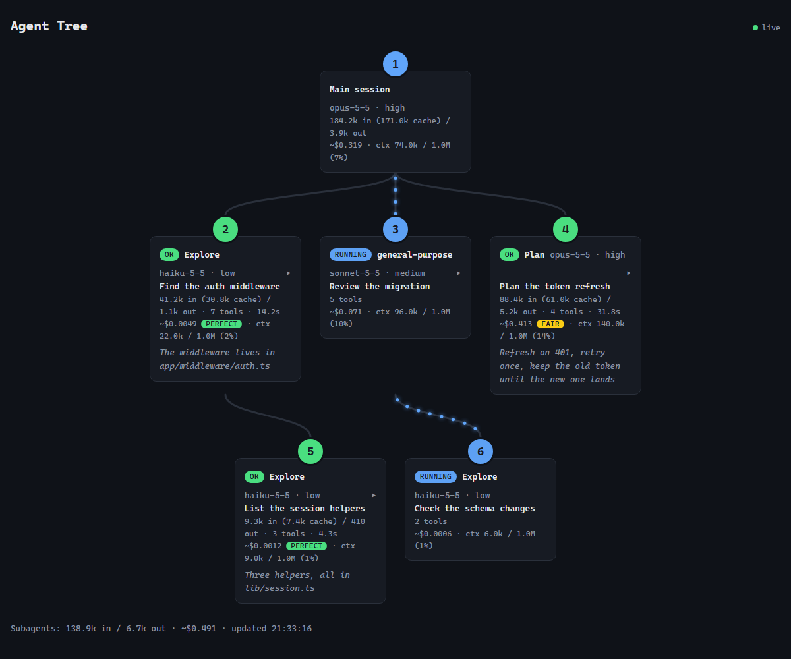

# Claude Code Mods

A mod is a Claude Code plugin made of function hooks. It can draw a live pane beside the transcript, a band above the prompt, a status line, or a toast. It can also block, rewrite, or react to any tool call, add slash commands, play sounds, and call the model. Mods hot-reload while you work.

Most of these show you what Claude and its agents are doing while they do it. All of them are MIT licensed. Fork them, break them, ship your own.

| Mod | Code | Command | What it does |
| --- | --- | --- | --- |
| [agent-tree](#agent-tree) | [`agent-tree/`](agent-tree/) | `/agent-tree` | Live tree of the orchestrator and its subagents with model, effort, tokens, cost and duration, in a pane or a local web page |
| [mission-control](#mission-control) | [`mission-control/`](mission-control/) | `/mission` | Live map of the main agent, its subagents and every tool call, plus a code map of the files they touch |
| [swarm](#swarm) | [`swarm/`](swarm/) | `/swarm` | Live map of subagents and agent teams: who spawned whom, what each is doing, who is talking |
| [agent-narrator](#agent-narrator) | [`agent-narrator/`](agent-narrator/) | `/narrate` | Every agent step in plain English, with a time-saved counter. Built for showing non-engineers |
| [agent-race](#agent-race) | [`agent-race/`](agent-race/) | `/race` | Race several Claude Code sessions on the same task on a live scoreboard |
| [context-bar](#context-bar) | [`context-bar/`](context-bar/) | `/context-bar` | Your context window as a stacked bar above the prompt, one colour per category, with the compaction point |
| [token-weather](#token-weather) | [`token-weather/`](token-weather/) | none | A weather forecast of the context window above the prompt, with a prompt-cache countdown |
| [inbox-alerts](#inbox-alerts) | [`inbox-alerts/`](inbox-alerts/) | `/alerts` | Gmail, Slack, and Calendar alerts inside Claude Code as toasts, a status count, and a pane |

## Install

Requires Claude Code 2.1.287 or later.

The fastest way is the plugin marketplace. In a Claude Code session:

```
/plugin marketplace add rzem-ai/claude-code-mods
/plugin install agent-tree@claude-code-mods
```

Swap `agent-tree` for any mod name in the table. To hack on them instead, clone the repo:

```bash
git clone https://github.com/rzem-ai/claude-code-mods.git ~/claude-code-mods
```

Try one for a single session:

```bash
claude --plugin-dir ~/claude-code-mods/agent-tree
```

Repeat `--plugin-dir` to load several. To load mods in every session (including the desktop app), add them to the `env` block of `~/.claude/settings.json`, separated by `:`:

```json
{
  "env": {
    "CLAUDE_CODE_PLUGIN_DIRS": "~/claude-code-mods/agent-tree:~/claude-code-mods/context-bar"
  }
}
```

Every mod has tests:

```bash
claude plugin validate ~/claude-code-mods/agent-tree
claude plugin test ~/claude-code-mods/agent-tree
```

`/narrate demo` and `/race demo` play a scripted session, so you can see those two without waiting for the real thing.

## The mods

### agent-tree

[Source](./agent-tree) · [README](./agent-tree/README.md) · `claude --plugin-dir ~/claude-code-mods/agent-tree`



An Agents pane with a live tree of the main session and every subagent it spawns: model, effort, tokens (input, cache, output), tool calls, duration and the first line of each answer. Each node also carries an estimated cost at list prices, a rating of what the run spent once it ends, and how full its context is. The same tree is served as a live web page on `127.0.0.1`, and on Windows it can open as its own Edge app window. `/agent-tree` asks again which of the three you want. A toast says when a subagent finishes, and a failed one raises a system notification.

### mission-control

[Source](./mission-control) · [README](./mission-control/README.md) · `claude --plugin-dir ~/claude-code-mods/mission-control`

`/mission` opens a pane with two views of the current turn. **who** is the main loop, its subagents and every tool call they make, live. **code** is a rendered map of the files Claude reads and edits, the imports between them, a glow on what it is touching right now, and one plain line on each change. `/mission code` and `/mission who` jump straight to a view. A band above the prompt sums it up while Claude works.

The code map is drawn by headless Chrome or Chromium on macOS and Linux; on Windows it opens as a page in your browser instead.

### swarm

[Source](./swarm) · [README](./swarm/README.md) · `claude --plugin-dir ~/claude-code-mods/swarm`


`/swarm` opens mission control for subagents and agent teams. An orchestration tree nests every agent under whoever spawned it, with its type, model, live action and tool-call count. Below it: a timeline of how the agents overlap, arcs and a log for messages between teammates, and an activity feed. A status line keeps the live count, and a toast sums up the run when the swarm stands down.

### agent-narrator

[Source](./agent-narrator) · [README](./agent-narrator/README.md) · `claude --plugin-dir ~/claude-code-mods/agent-narrator`


Translates every tool call into one plain-English sentence ("Reading the pricing page to find the old numbers") and keeps a running estimate of time saved. `/narrate smart` uses a model call per step; the default is rule-based and free. `/narrate demo` plays a scripted session. We built this for training sessions where the audience has never seen an agent work.

### agent-race

[Source](./agent-race) · [README](./agent-race/README.md) · `claude --plugin-dir ~/claude-code-mods/agent-race`


`/race start <race> [name]` in two or more sessions puts them on the same track. The pane shows each session's tool calls, files touched, and test runs live, and `/race done` crosses the finish line. Good for comparing models or prompts on the same task.

### context-bar

[Source](./context-bar) · [README](./context-bar/README.md) · `claude --plugin-dir ~/claude-code-mods/context-bar`

A band above the prompt that draws the context window as one stacked bar, a colour per category the way `/context` breaks it down (system prompt, tools, MCP tools, memory files, skills, messages, free space), with a legend of tokens and shares and a mark where auto-compaction kicks in. It refreshes after each turn and after a `/compact`, and costs no token-count calls. `/context-bar` hides or shows it, and the choice sticks across sessions.

### token-weather

[Source](./token-weather) · [README](./token-weather/README.md) · `claude --plugin-dir ~/claude-code-mods/token-weather`

A band above the prompt that turns context use into a forecast, from Clear through Cloudy, Showers and Storm to Compact soon, with a sparkline of the last few turns. Next to it, a countdown of how long the prompt cache stays warm after the last request. The cache lifetime (5 minutes or 1 hour) is detected from Claude's responses; set `cacheTtl` in `/config` to force one. If you run the cache-clock status line, the countdown steps aside for it.

### inbox-alerts

[Source](./inbox-alerts) · [README](./inbox-alerts/README.md) · `claude --plugin-dir ~/claude-code-mods/inbox-alerts`

Polls Gmail, Slack, and Google Calendar every two minutes through the claude.ai connectors, shows new items as toasts and a count in the status line, and keeps a tabbed Alerts pane. `/alerts triage` hands the backlog to Claude.

Needs the Gmail, Slack, and Google Calendar connectors connected in claude.ai. Set your email and Slack member ID in `/config` (or `pluginConfigs` in settings) so your own messages do not alert you.

### Stacking bands

context-bar, token-weather and mission-control all draw above the prompt, and they stack rather than fight. By default mission-control and token-weather sit above other mods' bands and context-bar sits below them. To pick the order yourself, write `~/.claude/claude-code-mods/bands.json` (or the same path under `CLAUDE_CONFIG_DIR`) listing mod names top to bottom; the last one sits right above the prompt:

```json
{ "order": ["mission-control", "token-weather", "context-bar"] }
```

Each mod reads the file once per session, so restart to apply a change.

## Security

A mod is code that runs inside Claude Code with your permissions. It is not sandboxed. Read a mod before you load it, and check what it touches without running it:

```bash
claude plugin validate ~/claude-code-mods/<mod>
```

The `hooks:` and `calls:` lines list every event it handles and everything it asks Claude Code to do. What these eight reach:

| Mod | Network | Runs processes | Files | Calls a model | Sends data anywhere |
| --- | --- | --- | --- | --- | --- |
| agent-tree | Local only: its own page server on `127.0.0.1` (ports 47821 to 47830), behind a per-session key | `node` (the page server); on Windows, Edge for the app window | No | No | Only to its own local page |
| mission-control | No | Headless Chrome or Chromium to draw the code map (macOS, Linux); `explorer.exe` to open it (Windows) | Reads the files Claude touches, to find their imports; writes the map to `$TMPDIR/mission-control/` (`%TEMP%` on Windows) | Yes, Haiku: after each turn that edits files, the paths and up to 1,500 characters of the edits per file, for the one-line change notes | Only to your Claude model |
| swarm | No | No | No | No | No |
| agent-narrator | No | No | No | Only with `/narrate smart`: the tool name and short fields (path, command), never file contents | Only to your Claude model |
| agent-race | No | No | Reads and writes `~/.claude/agent-race/<race>/` | No | No |
| context-bar | No | No | Reads the band order file | No | No |
| token-weather | No | `tail` (the end of this session's transcript) | Reads this session's transcript, your settings, and the band order file | No | No |
| inbox-alerts | Through your claude.ai Gmail, Slack and Calendar connectors | No | No | `/alerts triage` sends alert snippets to Claude | Only to your Claude model |

Notes:

- **mission-control sends your edits to Haiku.** Its change notes are written from the text of each edit, so whatever you or Claude write into a file (secrets included) goes to the model with it. This happens after every turn that edits files, whether or not the pane is open.
- **agent-tree's page holds your tool commands and answers.** The server binds `127.0.0.1` only, refuses any other `Host`, and serves the tree only with the key it makes at start-up, so another program or a website can't read or replace it. Anyone with the full link can, so don't paste it around.
- **inbox-alerts handles text other people wrote.** `/alerts triage` wraps every email and Slack snippet in an `<untrusted-alerts>` block, strips any attempt to close that block early, and tells Claude to treat the contents as data and never send, reply, or delete anything. That lowers prompt-injection risk; it does not remove it. Review what Claude proposes before acting on it.
- **The model-calling mods** send tool names, file paths, and short command or edit text to Claude. If your commands carry secrets inline, those go too. Keep secrets in environment variables.
- **No mod reaches the internet on its own**, and none phones home. agent-tree's server is the only socket any of them opens, and it is local.

Found a security issue? See [SECURITY.md](SECURITY.md).

## Writing your own

Ask Claude Code to make one. The built-in `plugin-authoring` skill knows the API: say "make a mod that..." and it writes the folder, validates it, and hot-reloads it into the session. Each mod here is three files at minimum:

```
my-mod/
  .claude-plugin/plugin.json   name, version, description
  hooks/hooks.json             { "modules": ["./register.tsx"] }
  hooks/register.tsx           export const register: Register = (on, options) => { ... }
```

## License

MIT. See [LICENSE](LICENSE).

Built by [rzem-ai](https://github.com/rzem-ai).
